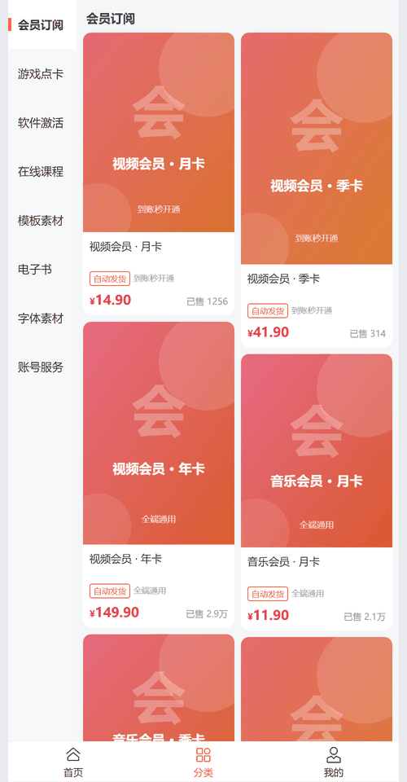
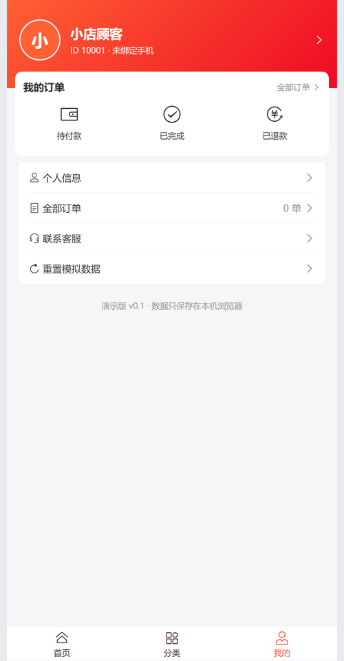

# 小店 · 个人 H5 商城（虚拟商品）

Vue 3 + Vite + Vant 4 的手机端商城基础架构。

**在线预览**：<https://zcube7.github.io/h5-shop/>（建议用手机打开，电脑上会以 480px 宽居中显示）

底部三个 Tab：

| 首页 | 分类 | 我的 |
|---|---|---|
|  |  |  |

- **首页**：顶部轮播 banner + 双列商品瀑布流（滚到底自动加载）
- **分类**：左侧分类栏 + 右侧该分类的瀑布流
- **我的**：个人信息（可编辑）+ 订单管理（待付款角标、按状态筛选）

完整下单流程：商品详情 → 确认订单 → 收银台（模拟支付）→ 订单详情（自动交付兑换码 / 链接 / 账号）→ 订单列表（取消、退款、再次购买）。

现在用的是**本地假数据**：商品是固定种子生成的 120 件（8 个分类），订单和个人信息存在浏览器 localStorage 里。

## 怎么跑

```bash
npm install
npm run dev        # http://localhost:4194
npm run test       # 订单状态机 + 瀑布流分列，21 条
npm run build      # 输出到 dist/，可以放到任何静态托管
npm run preview    # 本地预览打包结果 http://localhost:4195
```

- 手机上看：`npm run dev -- --host`，手机和电脑连同一个 Wi-Fi，打开终端里显示的 Network 地址。
- `dist/` 不能直接双击 `index.html` 打开（浏览器不允许 file:// 加载模块脚本），要用 `npm run preview` 或放到服务器上。
- 推送到 `main` 后，GitHub Actions 会自动跑测试、打包并发布到 GitHub Pages（`.github/workflows/deploy.yml`）。

## 目录

```
src/
  config.js              读 .env：是否用假数据、接口前缀、支付模式
  router/index.js        路由表；meta.tabbar=true 的页面显示底部栏
  App.vue                router-view + keep-alive（缓存首页、分类页）+ 底部 Tab
  api/                   页面只调这里的函数
    request.js           统一出口：假数据 / 真后端二选一，出错统一弹提示
    goods.js order.js user.js
  mock/                  假后端（换真后端后可以整个删掉）
    seed.js              商品库（固定种子）
    placeholder.js       本地生成的 SVG 占位图
    db.js                localStorage 读写
    server.js            接口路由 + 订单状态机 + deliverOrder 交付
  constants/             订单状态、状态文案、每个状态可做的操作、头像颜色
  composables/
    useKeepScroll.js     Tab 页切走再回来时恢复滚动位置
    useOrderActions.js   取消 / 退款 / 去支付 / 再次购买（列表和详情共用）
  components/
    WaterfallList.vue    双列瀑布流 + 分页加载（首页、分类页共用）
    GoodsCard.vue OrderCard.vue PayPanel.vue UserAvatar.vue
  views/
    home/ category/ mine/ goods/ order/
  utils/                 金额格式、瀑布流分列算法、复制、返回
tests/                   vitest
```

## 路由

| 路径 | 页面 |
|---|---|
| `#/home` | 首页 |
| `#/category?cid=c1` | 分类（cid 可选，带上就直接停在该分类） |
| `#/mine` | 我的 |
| `#/mine/profile` | 编辑个人信息 |
| `#/goods/:id` | 商品详情 |
| `#/order/confirm?goodsId=&qty=` | 确认订单 |
| `#/orders?status=pending` | 订单列表（status：all / pending / completed / refunded） |
| `#/order/:id?pay=1` | 订单详情（带 pay=1 会自动弹出收银台） |

## 订单状态（虚拟商品，付款即交付）

```
待付款 pending ──支付成功──▶ 已完成 completed ──申请退款──▶ 已退款 refunded
   │
   └──主动取消 / 15 分钟未支付──▶ 已取消 cancelled
```

- 金额全部用**整数分**存储和计算，只在显示时换算成元。
- 支付成功后由 `deliverOrder()`（`src/mock/server.js`）按商品类型生成交付内容：兑换码 / 下载链接 + 提取码 / 账号 + 初始密码，买几件生成几份。
- 退款后交付内容标记为「已失效」。
- 超时取消不需要定时器：每次读订单时，过期的待付款订单就地改成已取消。
- 下单后用 `router.replace` 跳订单详情，返回时直接回到商品详情，不会回到确认页重复下单。

## 换成真后端

1. `.env` 里把 `VITE_USE_MOCK` 改成 `false`，`VITE_API_BASE` 填接口前缀（开发时可在 `vite.config.js` 配 `server.proxy` 转发）。
2. 后端按下面的约定实现接口：GET 参数走 query，POST 走 JSON body，返回 `{ code: 0, data, message }`，`code !== 0` 视为失败（前端会弹出 `message`）。

| 接口 | 参数 | 返回 data |
|---|---|---|
| `GET /banners` | | `[{ id, title, image, link: { type: 'goods'\|'category', id } }]` |
| `GET /categories` | | `[{ id, name }]` |
| `GET /goods/feed` | `categoryId?, page, size` | `{ list, page, size, total, hasMore }` |
| `GET /goods/detail` | `id` | 商品详情（含 `images`、`description`、`notice`、`limit`、`deliverType`） |
| `POST /orders/create` | `goodsId, quantity, remark` | 待付款订单 |
| `POST /orders/pay` | `orderId` | 已完成订单（含 `deliverables`）；接真支付时改成「返回支付参数」，见下 |
| `POST /orders/cancel` | `orderId` | 订单 |
| `POST /orders/refund` | `orderId, reason` | 订单 |
| `GET /orders/list` | `status, page, size` | `{ list, page, size, total, hasMore }` |
| `GET /orders/detail` | `id` | 订单 |
| `GET /orders/counts` | | `{ all, pending, completed, cancelled, refunded }` |
| `GET /user/profile` / `POST /user/profile` | `nickname, avatarColor, phone, email, bio` | 个人信息 |

字段的具体形状以 `src/mock/server.js` 为准（它就是一份能跑的接口说明）。

3. 接真支付：把 `.env` 的 `VITE_PAY_MODE` 改成 `real`，在 `src/components/PayPanel.vue` 的 `onPay` 里改成「请求支付参数 → 拉起支付 → 轮询订单状态」；后端在支付回调里调用自己的交付逻辑（对应 mock 里的 `deliverOrder`）。页面其余部分不用动。

## 还没做（按需再加）

- 登录 / 多用户：现在是一个写死的假用户（ID 10001）。
- 购物车：虚拟商品只做了「立即购买」。
- 搜索、商品收藏、客服（按钮目前只弹提示）。
- 真实图片：现在是本地生成的色块占位图，换成真图片地址即可，瀑布流需要接口返回图片宽高（`image: { url, w, h }`）。
- 库存与销量不随下单变化（假数据里是固定值）。

## 开发备注

- `vite.config.js` 里把 Vant 每个组件的样式入口都列进了 `optimizeDeps.include`。不列的话，开发时第一次进某个页面，Vite 发现新依赖会整页刷新一次，缓存的首页 / 分类页状态就丢了。
- `useKeepScroll` 要忽略「元素已脱离文档」时的 scroll 事件：Chrome 在页面被切走后会补发一次 scrollTop=0 的 scroll 事件，不忽略的话滚动位置会被清零。

## 许可证

[MIT](LICENSE)。依赖的 Vue、Vant、Vite 等均为 MIT 许可证，通过 npm 安装，不随仓库分发。商品图是代码生成的色块占位图，商品名、价格、销量均为随机演示数据。
